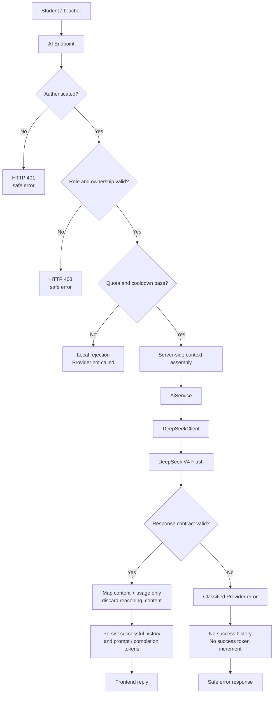

# AI 教学纵切

学生错题 Agent 与教师课程健康度共用同一条生成管线。图中 success 指“完整响应通过合同校验并成功持久化”，不是只收到 Provider 的 HTTP 响应。

## 成功门

只有同时满足以下条件才会形成成功历史：

- Provider 返回 HTTP 200；
- 唯一 choice 的 `finish_reason` 为 `stop`；
- 不包含工具调用，`content` 非空；
- prompt、completion、total 三项 usage 合法，且 total 与前两项之和一致。

应用只把最终 content 和 usage 映射进内部结果；`reasoning_content` 没有业务字段，不返回前端、不写数据库，也不进入安全日志。

## 失败与防滥用

- 身份、角色或资源归属不通过时，分别在 Provider 之前返回 401/403。
- 成功用量由 AI 历史统计；防滥用账本使用共享 Redis Lua 原子预留，每账号限制在途请求并按角色执行每日预算和冷却。失败保留保守预留，删除历史不退还额度。
- 额度不足或冷却命中时不发起 Provider 请求。
- 未配置、400、401、402、422、429、timeout、5xx、格式错误或不完整生成会映射为安全提示；不落成功历史、不增加成功 token，且不自动 retry。

## 历史真实调用范围

本次更新只跑 mock 和未配置分支；以下为此前历史记录，不代表当前供应商已重新验证。

- 此前真实 Provider E2E 覆盖学生错题 Agent 与教师课程健康度，共 2 次成功、0 次 Provider failure、0 次 retry。
- 学生首次成功后 3.245 秒内再次提交，冷却在 Provider 前拦截，历史与 token 未增加。
- 其余 4 个生成入口通过 fake server 与请求级合同测试验证，不描述为真实 Provider 调用。
