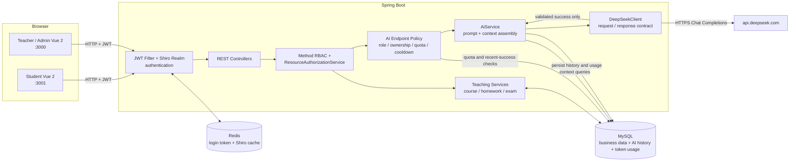

# 系统架构

这张图只保留招聘 Demo 主链路。它描述当前双前端、Spring Boot 多模块后端、认证/授权、教学业务和 AI Provider 之间的关系；不是全部接口或 36 张表的穷举。

## 读图要点

- 学生端和教师/管理端是两套 Vue 2 应用，共用一套后端 API。
- 认证与授权分层：filter/realm 建立身份，方法级角色注解限制入口，资源守卫继续校验课程及其子资源的 ownership。
- Redis 承担登录 token 与 Shiro 缓存；教学数据、AI 成功历史和 token 用量以 MySQL 为事实来源。
- AI 请求先经过角色、资源归属、每日额度和冷却检查，再组装服务端上下文并调用统一 Provider client。
- 只有通过响应合同校验的生成结果才写入成功历史；失败路径不增加成功生成次数或 token。

## 当前边界

- 该授权结构集中覆盖招聘 Demo 与教学主链路，不代表文章、论坛等所有资源接口都已完成 ownership 治理。
- 当前运行基线是本机 MySQL、Redis 与三进程前后端，不代表生产部署或多实例能力。
- 请求内冷却预留位于单个后端 JVM；最近成功历史由数据库补充校验，但多实例并发冷却尚未实现。
